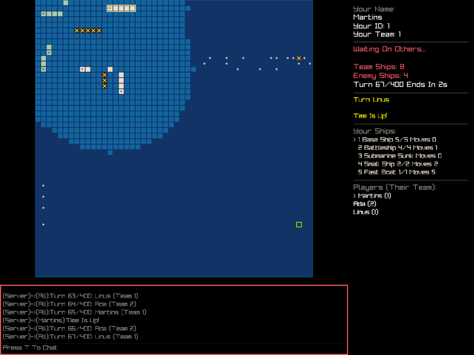
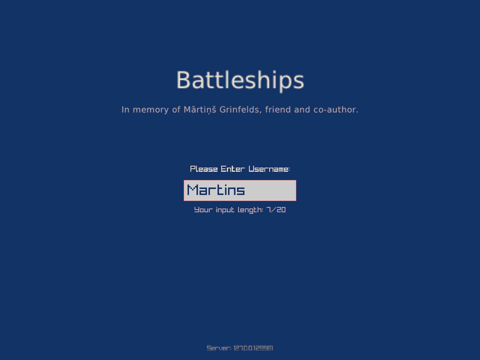
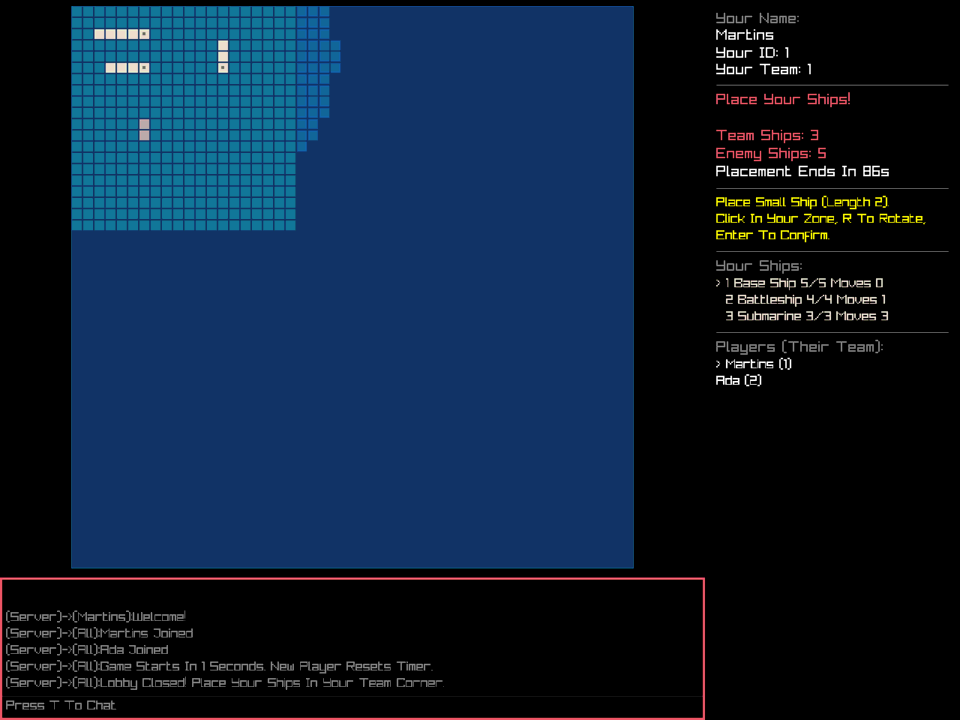
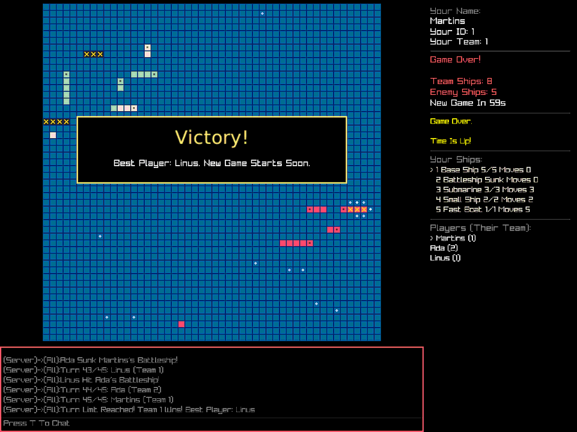

# Battleships
Multiplayer ship destruction game written in C. Teams of players move their ships around a shared
sea, hunt each other through the fog of war and try to be the last team afloat.



## Dedication
*In memory of Mārtiņš Grinfelds, friend and co-author.*

Battleships began in 2022 as a project for the "Linux System Programming" course at the University
of Latvia, written by two friends who share the name Mārtiņš. It was the hardest task of the course
for both of them, and for Mārtiņš Grinfelds it stayed a place to learn and experiment long after
university. The game was finished in his memory, on top of the code the two of them wrote.



## How to play
1. Start the server: `./BattleshipsServer`
2. Every player starts the client: `./BattleshipsClient --host SERVER_ADDRESS` and enters a name.
3. Not enough friends online? Add computer players: `./BattleshipsBot --host SERVER_ADDRESS --name "Bot 1" --games 0`

The game has three stages:

**Lobby.** Players join and get a team (2-4 teams). When enough players have joined, the server
waits 30 seconds for more (every new player resets the timer) and then closes the lobby.
Players who join later can watch the game.

**Ship placement.** Each team has its own corner of the map (lighter sea). Place your five ships there:
click on a square, press `R` to rotate, press `Enter` to confirm. If time runs out, the remaining ships
are placed randomly.



**Battle.** Teams take turns; if a team has several players, they take turns too. In your turn:

| Key | Action |
|-----|--------|
| `1`-`5` (or numpad) | Select ship |
| Arrow in direction ship faces | Move one square forward |
| Arrow to the side | Turn 90 degrees (ships can't turn around 180 degrees) |
| Left click on map | Shoot at square with selected ship (green frame = in range) |
| `Enter` | End turn |
| `T` | Chat (`Tab` chooses receiver, `Enter` sends, `Esc` closes) |

You see only what your team's ships can see. Your team remembers where it shot: `X` is a hit, a dot is a miss.
Damaged ships cannot move. Sunk ships are visible to everyone.

| # | Ship | Length | Moves per turn | Shooting range |
|---|------|--------|----------------|----------------|
| 1 | Base Ship | 5 | 0 | Whole map (airplanes on board) |
| 2 | Battleship | 4 | 1 | 25 squares |
| 3 | Submarine | 3 | 3 | Any distance along its row or column (torpedoes) |
| 4 | Small Ship | 2 | 2 | 10 squares |
| 5 | Fast Boat | 1 | 5 | Can't shoot, but sees 15 squares instead of 10 |

The game ends when only one team has ships left. It also ends after 150 turns, or when no ship can
reach an enemy anymore (for example only Fast Boats are left, or damaged ships are out of each
other's range); then the team with the most undamaged ship squares wins. After a few seconds a new lobby opens.



If a player loses connection, the client reconnects by itself and the player gets their ships back.
A team that stays away longer than 60 seconds loses.

## Prerequisites
> [!NOTE]
> Code is designed to work on Linux system. It should be obvious to run it only on Linux or WSL. macOS works too.

### Ensure you have:
- `gcc` (for compiling)
- `make` (for using Makefile)
- `python3` (only for tests)

### Ensure such libraries are installed (for the graphical client):
There are instructions for raylib graphical interface: https://github.com/raysan5/raylib/wiki/Working-on-GNU-Linux.
To make sure it is working you need to install some libraries used by raylib:

<b>Ubuntu:</b>
```sh
sudo apt install libasound2-dev libx11-dev libxrandr-dev libxi-dev libgl1-mesa-dev libglu1-mesa-dev libxcursor-dev libxinerama-dev libwayland-dev libxkbcommon-dev
```
<b>Fedora:</b>
```sh
sudo dnf install alsa-lib-devel mesa-libGL-devel libX11-devel libXrandr-devel libXi-devel libXcursor-devel libXinerama-devel libatomic
```
<b>Arch:</b>
```sh
sudo pacman -S alsa-lib mesa libx11 libxrandr libxi libxcursor libxinerama
```

### Install raylib itself:
On Linux x86-64 nothing else is needed: raylib 5.0 is included in `external_libraries/`.

On macOS (or other processors) install raylib, for example with brew: https://brew.sh/ <b>AND FOLLOW INSTRUCTIONS TO ADD BREW BINS TO PATH</b>
```sh
brew install raylib
```
The server and the bot don't need raylib at all.

## To compile
You can use predefined `Makefile` instructions or compile any other way
if you know how to.
### There are several commands/targets implemented:
- `make` same as `make all` (server, client and bot)
- `make BattleshipsServer`
- `make BattleshipsClient`
- `make BattleshipsBot`
- `make run_server`
- `make run_client`
- `make run_bot BOTS=3` <i>Adds three computer players to local server</i>
- `make test` <i>Unit tests and complete games played by bots</i>
- `make sanitize` <i>Same tests with memory error and leak detection</i>
- `make clean` <i>Good old clean if something is not working right</i>

> [!NOTE]
> All commands here will automatically do things necessary.

## Client options
```
./BattleshipsClient --host example.com --port 12345 --name Martins --size 1600x1000
```
Without `--name`, the client asks for a name. The window can be resized.

## Running a server
Every setting can be given on the command line or in a config file (see `./BattleshipsServer --help`
and [`deploy/server.conf.example`](deploy/server.conf.example)):
```sh
./BattleshipsServer --port 12345 --teams 4 --min-players 4 --turn-time 45
./BattleshipsServer --config server.conf --verbose 1
```
Players need TCP access to the port (default 12345). The server logs with timestamps to standard
output and stops cleanly on `Ctrl+C` or `SIGTERM`.

**systemd:** [`deploy/battleships-server.service`](deploy/battleships-server.service) has install steps.

**Docker** (server and bot only, no graphics):
```sh
docker build -t battleships-server .
docker run -d --name battleships -p 12345:12345 battleships-server --teams 3
```

> [!NOTE]
> There are no passwords: a name is the identity of a player. Anyone who knows the name of a
> disconnected player can take their place during a game. This is fine among friends; don't expect
> more from it.

## Testing
`make test` runs:
- **Unit tests** (`tests/unit_tests.c`): packet serialization, packet framing over real sockets
  (packets arriving byte by byte, broken checksums, old sequence numbers), game rules and config.
- **Integration tests** (`tests/integration_test.sh`): real server and bots play complete games,
  including 4 teams, observers and a chaos test where packets arrive in tiny pieces, players
  disconnect and come back, and `tests/garbage_client.py` attacks the server with broken data.

`make sanitize` runs the same with AddressSanitizer and UndefinedBehaviorSanitizer.
GitHub Actions runs it on every push.

`tests/xinput.py` can play the graphical client by sending mouse and keyboard events to an X display
(for example `Xvfb`), which is how the client was tested without a screen.

## Project structure
| Path | What it is |
|------|------------|
| `server.c` | Server: lobby, teams, turns, rules, fog of war |
| `client.c` | Graphical client (raylib) |
| `bot.c` | Computer player |
| `game/` | Game rules shared by everyone (no network or graphics) |
| `packets/` | Packets and TCP connection handling ([protocol](docs/PROTOCOL.md)) |
| `graphical/` | Map, status area, chat, title screen |
| `utils/` | Timers and server config |
| `tests/` | Tests |
| `deploy/` | Server config example and systemd service |

Game rules and protocol IDs (like `LOGC-0012`) come from the
[wiki](https://github.com/MartinsGrinfelds/battleships-in-c/wiki).
[docs/PROTOCOL.md](docs/PROTOCOL.md) describes what was added to the protocol to finish the game.

Graphics use [raylib](https://www.raylib.com/). The title screen uses
DejaVu Sans (see `external_libraries/fonts/DejaVu-LICENSE.txt`).
